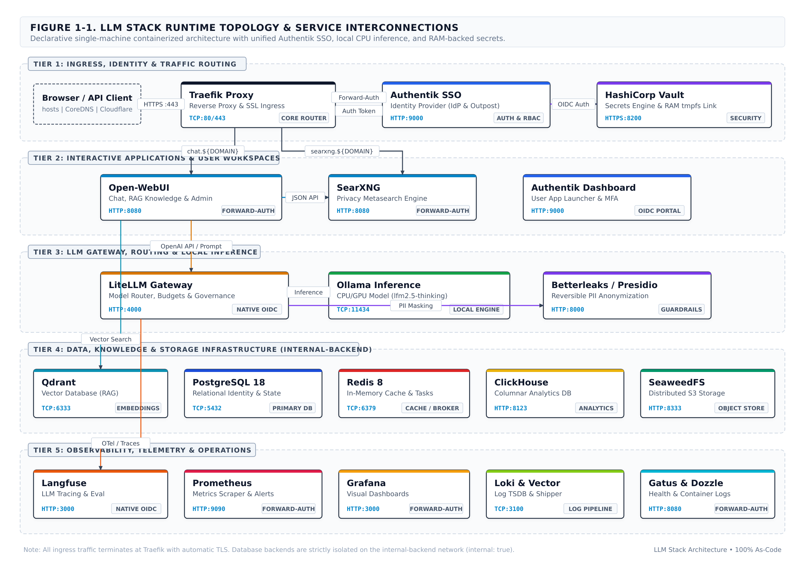

# LLM Stack — Self-Hosted LLM & LLMOps Platform

<p align="center">
  <a href="https://github.com/jaseran-ai/llm-stack/actions/workflows/ci.yml">
    
  </a>
  <a href="SECURITY.md">
    
  </a>
  <a href="CODE_OF_CONDUCT.md">
    
  </a>
  <a href="LICENSE">
    
  </a>
</p>

---

<p align="center">
  
</p>

---

## 🌟 What is LLM Stack?

**LLM Stack** is an enterprise-grade, 100% declarative, self-hosted LLM and LLMOps platform. It delivers a complete private AI ecosystem on a single machine or homelab — from local CPU-friendly inference to secure multi-user chat, vector RAG, prompt tracing, and observability.

### Why this stack?
- 🚀 **100% As-Code & Fully Automated**: Zero manual GUI clicks. Secrets are generated dynamically, configurations are versioned as code, and the entire stack boots deterministically via `./setup.sh`.
- 🔒 **Unified Identity & Zero Trust**: Single Sign-On (SSO) and Role-Based Access Control (RBAC) enforced across every application via **Authentik** (Forward-Auth & Native OIDC).
- ⚡ **Zero-GPU Required**: Ships with an embedded CPU-friendly model (`lfm2-1.2b-rag` via Ollama) ready immediately out of the box — zero external API keys or expensive GPU hardware required.
- 🧠 **Context & Knowledge RAG**: High-performance vector embeddings via **Qdrant** and private web search through **SearXNG** integrated directly into **Open-WebUI**.
- 📊 **Enterprise LLMOps**: Centralized prompt routing, rate limiting, and token governance with **LiteLLM**, deep tracing with **Langfuse**, and full-stack metrics & logs via **Prometheus**, **Grafana**, and **Loki**.
- 🛡️ **Defense-in-Depth**: Secrets managed by HashiCorp Vault rendered into isolated memory-backed RAM `tmpfs` (`0700`), with automated PII anonymization via **Presidio / Betterleaks**.

---

## ⚡ Quick Start

### Prerequisites
- Linux or macOS with **Docker** & **Docker Compose v2** (24.0+)
- **OpenSSL** (used by `setup.sh` to generate cryptographic secrets)
- Minimum: **8 GB RAM** and **4 CPU cores** (~7 GB baseline memory usage across all core containers)

### 3-Step Setup

```bash
# 1. Clone the repository
git clone https://github.com/jaseran-ai/llm-stack.git
cd llm-stack

# 2. Initialize environment & DNS mode
# Choose: --dns-mode=hosts (default), --dns-mode=coredns, or --dns-mode=cloudflare
./setup.sh --dns-mode=coredns

# 3. Start the stack
./start.sh
```

Once running, access the **Authentik Application Dashboard** at `https://authentik.llm.local` (or your chosen `${DOMAIN}`) using the credentials printed by `setup.sh`.

---

## 🌐 3-Mode Declarative DNS Architecture

| Mode | Setup Command | Network Routing | Ideal Use Case |
| :--- | :--- | :--- | :--- |
| **`/etc/hosts`** | `./setup.sh --dns-mode=hosts` | Direct loopback IP in local hosts file | Fast single-workstation local development |
| **CoreDNS** | `./setup.sh --dns-mode=coredns` | Embedded LAN wildcard DNS daemon (`:53`) | Multi-device local network & homelab without NAT |
| **Cloudflare** | `./setup.sh --dns-mode=cloudflare` | Outbound TLS/QUIC Zero Trust Tunnel | Public HTTPS access with zero open inbound ports |

*Traefik handles TLS termination via `TLS_MODE=internal` (local CA), `custom` (certificate from your own CA, CSR generated by `./setup.sh --tls-csr`), `http-01` (Let's Encrypt), or `cloudflare-dns01`. See [`traefik/README.md`](traefik/README.md).*

---

## 📦 Services Catalog & Per-Service Documentation

Each service in LLM Stack has a dedicated technical guide detailing its Docker configuration, persistent volumes, environment variables, and healthchecks:

| Tier | Service | Primary Role | Auth Model | Technical Documentation |
| :--- | :--- | :--- | :--- | :--- |
| **Ingress & Security** | **Traefik** | Reverse Proxy, SSL Termination & Routing | Core Ingress | [`traefik/README.md`](traefik/README.md) |
| | **Authentik** | IdP, OAuth2/OIDC & Forward-Auth SSO | Identity Source | [`authentik/README.md`](authentik/README.md) |
| | **Vault** | Cryptographic Secrets & RAM tmpfs Engine | Internal Core | [`vault/README.md`](vault/README.md) |
| | **CoreDNS** | LAN Wildcard DNS Resolution Daemon | Profile: `coredns` | [`coredns/README.md`](coredns/README.md) |
| | **Cloudflared** | Zero Trust Outbound Ingress Tunnel | Profile: `cloudflare` | [`cloudflare/README.md`](cloudflare/README.md) |
| **UI & Search** | **Open-WebUI** | Multi-Model AI Chat & RAG Workspace | Forward-Auth | [`open-webui/README.md`](open-webui/README.md) |
| | **SearXNG** | Privacy-Preserving Metasearch Engine | Forward-Auth | [`searxng/README.md`](searxng/README.md) |
| **LLM Gateway & AI** | **LiteLLM** | LLM Proxy Router, Auth & Governance | Native OIDC | [`litellm/README.md`](litellm/README.md) |
| | **Ollama** | Bundled Local CPU/GPU Inference Engine | Internal | [`ollama/README.md`](ollama/README.md) |
| | **Betterleaks** | Reversible PII Anonymization & Guardrail | Internal Proxy | [`betterleaks/README.md`](betterleaks/README.md) |
| **Data & Storage** | **Qdrant** | Production Vector Database for RAG | Forward-Auth | [`qdrant/README.md`](qdrant/README.md) |
| | **PostgreSQL** | Relational Database (Authentik, Langfuse) | Internal Backend | [`postgres/README.md`](postgres/README.md) |
| | **Redis** | In-Memory Cache & Task Queue Broker | Internal Backend | [`redis/README.md`](redis/README.md) |
| | **ClickHouse** | Columnar Analytics Engine for LLM Traces | Internal Backend | [`clickhouse/README.md`](clickhouse/README.md) |
| | **SeaweedFS** | High-Performance S3 Blob Storage | Forward-Auth & SigV4 | [`seaweedfs/README.md`](seaweedfs/README.md) |
| **LLMOps & Monitoring**| **Langfuse** | LLM Tracing, Evaluation & Metrics | Native OIDC | [`langfuse/README.md`](langfuse/README.md) |
| | **Grafana** | Unified Dashboards & Visual Metrics | Forward-Auth | [`grafana/README.md`](grafana/README.md) |
| | **Prometheus** | Metric Scraping & Alert Rules Engine | Forward-Auth | [`prometheus/README.md`](prometheus/README.md) |
| | **Loki & Vector** | Centralized Container Log Aggregation | Internal Pipeline | [`loki/README.md`](loki/README.md) |
| | **Dozzle** | Real-Time Container Log Streamer | Forward-Auth | [`dozzle/README.md`](dozzle/README.md) |
| | **Gatus** | GitOps-Native Automated Health Monitor | Forward-Auth | [`gatus/README.md`](gatus/README.md) |

---

## 📚 Complete Documentation Portals

Comprehensive user guides and architecture specifications are published online and bundled as bilingual Docusaurus portals:

- **[📖 User Guide & Tutorials](https://jaseran-ai.github.io/llm-stack/)** (`docs/user`): Diataxis-structured guide covering chat workflows, document RAG indexing, search engine integration, and user onboarding.
- **[📐 Architecture & Engineering Specification](https://jaseran-ai.github.io/llm-stack/architecture/)** (`docs/architecture`): arc42 architecture specification, C4 model diagrams, Threat Modeling, Architecture Decision Records (ADRs 0001–0008), and network topology.

---

## 🤝 Community & Contributing

We welcome community contributions, bug reports, and suggestions!

- **[Contributing Guidelines](CONTRIBUTING.md)**: Development workflow, testing with `./smoke_test.sh`, and opening pull requests.
- **[Security Policy](SECURITY.md)**: Vulnerability disclosure and defense-in-depth security model.
- **[Code of Conduct](CODE_OF_CONDUCT.md)**: Contributor Covenant v2.1 standards.
- **[Architectural Governance Rules](AGENTS.md)**: The 11 core architectural commandments governing all changes to the stack.
- **[Project Roadmap](ROADMAP.md)**: Planned capabilities.

---

<p align="center">
  <sub>Built with ❤️ by the LLM Stack Community • Open Source under the MIT License</sub>
</p>
