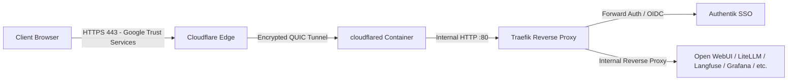

# Cloudflare Zero Trust Tunnel & DNS - Terraform Module

This Terraform module provides **declarative, reproducible Infrastructure as Code (IaC)** to manage the **Cloudflare Zero Trust Tunnel** (`cloudflared`) and all configured DNS CNAME records for this stack.

---

## 🏛️ Routing Architecture



### Architecture Highlights:
* **Zero Open Inbound Ports**: No inbound ports (80/443) need to be exposed on your server or router firewall.
* **Automatic SSL/TLS Termination**: Cloudflare Edge handles public HTTPS certificate management (`*.yourdomain.com`).
* **Internal HTTP Routing**: The tunnel forwards traffic directly to Traefik on port 80 inside the private Docker network, eliminating self-signed TLS certificate conflicts.

---

## 📁 `cloudflare/` Directory Structure

```text
cloudflare/
├── main.tf                 # Resource definitions (Tunnel, Ingress Rules & CNAME Records)
├── variables.tf            # Variable declarations with neutral default placeholders
├── outputs.tf              # Tunnel IDs and list of routed subdomains
├── terraform.tfvars.example # Example configuration template (tracked in Git)
└── terraform.tfvars        # Your real secrets and domain (GIT-IGNORED - never commit)
```

> [!IMPORTANT]
> **Git Anonymity & Security**:
> All tracked files (`main.tf`, `variables.tf`, `outputs.tf`, `terraform.tfvars.example`) use generic placeholder domains (`example.com`). Your real domain, account ID, and API tokens are kept strictly inside `terraform.tfvars` (which is excluded by `.gitignore`).

---

## 📋 Prerequisites

1. **Terraform CLI** installed (`terraform -version >= 1.5.0`).
2. **Cloudflare Account** with an active domain (e.g. `example.com`).
3. **Cloudflare API Token** with the following permissions:
   * **Account** $\rightarrow$ **Cloudflare Tunnel** $\rightarrow$ **Edit**
   * **Zone** $\rightarrow$ **DNS** $\rightarrow$ **Edit**
   * **Zone** $\rightarrow$ **Zone** $\rightarrow$ **Read**

---

## 🚀 Usage Guide

### 1. Configure Private Variables

Copy the example configuration file:

```bash
cp cloudflare/terraform.tfvars.example cloudflare/terraform.tfvars
```

Edit `cloudflare/terraform.tfvars` with your credentials:

```hcl
cloudflare_api_token  = "your_cloudflare_api_token"
cloudflare_account_id = "your_cloudflare_account_id"
domain                = "example.com"
tunnel_name           = "llm-stack-tunnel"
tunnel_secret         = "your_base64_32_byte_secret"
```

### 2. Initialize Terraform

```bash
cd cloudflare
terraform init
```

### 3. Review Plan

```bash
terraform plan
```

### 4. Apply Configuration

```bash
terraform apply -auto-approve
```

---

## 🔄 Injecting the Tunnel Token into the Docker Stack

After applying the configuration, Terraform outputs the generated `tunnel_token`. To connect the `cloudflared` Docker container:

1. Retrieve the tunnel token:
   ```bash
   cd cloudflare
   terraform output -json
   ```

2. Update `CLOUDFLARE_TUNNEL_TOKEN` in your `.env` file at the root of the repository.

3. Start or restart the `cloudflared` container:
   ```bash
   docker compose up -d cloudflared
   ```

---

## 💥 Disaster Recovery & Recreation

To tear down the entire tunnel and DNS records from Cloudflare:

```bash
cd cloudflare
terraform destroy -auto-approve
```

To recreate everything from scratch:

```bash
terraform apply -auto-approve
```

---

## 🌐 List of Routed Subdomains
| Service | Public Subdomain | Internal Ingress Target |
| :--- | :--- | :--- |
| **Open WebUI (Chat)** | `https://chat.<domain>` | `http://traefik` |
| **Authentik (SSO Portal)** | `https://authentik.<domain>` | `http://traefik` |
| **LiteLLM Gateway** | `https://litellm.<domain>` | `http://traefik` |
| **Langfuse LLMOps** | `https://langfuse.<domain>` | `http://traefik` |
| **Grafana Dashboards** | `https://grafana.<domain>` | `http://traefik` |
| **Dozzle Container Logs** | `https://logs.<domain>` | `http://traefik` |
| **SearXNG Metasearch** | `https://searxng.<domain>` | `http://traefik` |
| **SeaweedFS S3 API** | `https://s3.<domain>` | `http://traefik` |
| **SeaweedFS Filer Console** | `https://s3-console.<domain>` | `http://traefik` |
| **ClickHouse Admin UI** | `https://clickhouse.<domain>` | `http://traefik` |
| **Qdrant Vector DB** | `https://qdrant.<domain>` | `http://traefik` |
| **Traefik Ingress Dashboard** | `https://traefik.<domain>` | `http://traefik` |
| **Alertmanager Dashboard** | `https://alertmanager.<domain>` | `http://traefik` |
| **HashiCorp Vault UI** | `https://vault.<domain>` | `http://traefik` |
| **Gatus Status Dashboard** | `https://status.<domain>` | `http://traefik` |
