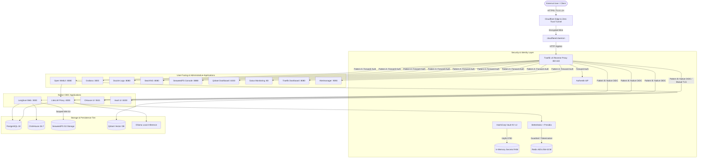

# LLM Stack — Security & Systems Architecture Specification

> [!IMPORTANT]
> **This specification has been migrated to the arc42 + C4 Architecture Documentation site.**
> Please refer to:
> - **arc42 Specification & ADRs**: [`docs/architecture/`](architecture/)
> - **C4 Structurizr Model**: [`docs/architecture/docs/c4/workspace.dsl`](architecture/docs/c4/workspace.dsl)
> - **ADR Log**: [`docs/shared/DECISIONS.md`](shared/DECISIONS.md)

---

The `llm-stack` platform is an enterprise-grade, self-hosted, fully containerized infrastructure designed for serving, observing, and securing Large Language Models (LLMs).

The architecture is governed by four immutable engineering principles:

1. **Configuration as Code (CaC) & Absolute Reproducibility**:
   The entire stack must be 100% reproducible from a clean repository clone via `./setup.sh` and `docker compose up -d`. Manual graphical configuration, undocumented database manipulations, and untracked environment drift are strictly prohibited.
2. **Zero-Trust Security by Default**:
   Every layer assumes the network is hostile. Implicit trust between containers, unauthenticated endpoints, plain-text secret storage, and global TLS verification bypasses are categorically eliminated.
3. **Single-Node Portability & Resource Efficiency**:
   The stack is optimized to run autonomously on a single host (developer workstation, homelab server, or cloud VM) without external cloud dependencies. CPU-friendly inference models (`lfm2-1.2b-rag` via Ollama) ensure zero-hardware-barrier out-of-the-box operation.
4. **Empirical Validation ("Prove It Works")**:
   No architectural or security mechanism is considered complete until validated by automated test suites (`./smoke_test.sh` 28/28 test suites, `make lint`, and `make trivy`).

---

## 2. Global Architecture Diagram

---

## 3. Security Architecture Pillars

### 3.1 Perimeter Security & Cloudflare Zero Trust IaC
- **Zero Exposed Host Ingress Ports**: No public host port is bound to the public interface for application traffic. All external traffic enters through the outbound `cloudflared` tunnel daemon.
- **Edge Security & Minimum TLS**: Cloudflare Zero Trust edge enforces `min_tls_version = "1.2"` and full origin strict encryption.
- **Declarative DNS Anti-Spoofing**:
  - Strict `_dmarc` TXT policy: `v=DMARC1; p=reject; sp=reject; adkim=s; aspf=s;` prevents email domain spoofing.
  - Certificate Authority Authorization (CAA) records explicitly restrict certificate issuance to Let's Encrypt (`letsencrypt.org`) and Google Trust Services (`pki.goog`).
- **Traefik Ingress Hardening**:
  - Global production security headers middleware (`security-headers@file`):
    - `HSTS`: `max-age=31536000; includeSubDomains`
    - Clickjacking protection: `X-Frame-Options: DENY`
    - MIME-type sniffing prevention: `X-Content-Type-Options: nosniff`
    - Referrer leakage mitigation: `Referrer-Policy: strict-origin-when-cross-origin`

### 3.2 Unified Identity & Single Sign-On (Authentik)
Authentik serves as the single source of truth for identity and Role-Based Access Control (RBAC).

#### 3.2.1 Integration Patterns
1. **Pattern A — Traefik Forward-Auth Middleware**:
   Applied to services lacking native OIDC client capabilities. Traefik evaluates authentication and group membership (`admins` vs `users`) before forwarding requests upstream.
   *Protected services*: Open WebUI, Grafana, Dozzle, SearXNG, SeaweedFS Console, Qdrant UI, Gatus, Traefik Dashboard, Alertmanager.
2. **Pattern B — Native OpenID Connect (OIDC)**:
   Applied to modern distributed services capable of federating directly with an IdP. Traefik proxies TLS traffic while the application negotiates OAuth2 authorization codes directly against Authentik.
   *Integrated services*: LiteLLM, Langfuse, CHouse UI, HashiCorp Vault.

#### 3.2.2 Greenfield 3-Tier Declarative Blueprints
Authentik configurations are provisioned entirely via declarative YAML blueprints partitioned into strict execution tiers to prevent transaction deadlocks:
- **Tier 00 (`00-system`)**: Core system tenants, certificate authorities, scopes, and RBAC groups (`admins`, `users`).
- **Tier 10 (`10-forward-auth`)**: Forward-Auth proxy providers collocated with the embedded outpost binding. Collocation inside a single transaction unit eliminates Celery worker serialization conflicts.
- **Tier 20 (`20-oauth2`)**: Native OAuth2/OIDC provider configurations, client IDs, redirects, and Authentik Application Dashboard tiles with verified CDN icons.

### 3.3 Secrets Management & Zero-Disk Memory Architecture (HashiCorp Vault)
- **Zero Hardcoded Secrets & Zero Fallbacks**: Environment variables in `docker-compose.yml` use strict `${SECRET}` syntax without defaults.
- **Dynamic Seeding**: `setup.sh` generates cryptographically secure secrets (`openssl rand -hex 32`) and injects them directly into Vault KV v2 storage via `vault/scripts/provision.py`.
- **AppRole Authentication**: `vault-agent` authenticates using a scoped, read-only AppRole policy rather than ephemeral or root tokens.
- **Memory-Backed tmpfs Mount (`secrets_ram`)**:
  - Rendered `.env` and configuration files are written exclusively to a 64MB memory-backed tmpfs (`/vault/secrets_ram`).
  - Strict filesystem permissions (`0700` directory, `0600` secret files) prevent non-root and multi-tenant disclosure.
  - Secret payloads reside only in RAM and are never persisted to physical disk blocks.

### 3.4 Internal TLS & Local CA Trust Plane
- **Encrypted Internal Listener**: HashiCorp Vault operates an internal TLS listener (`tls_disable = 0`) using local certificates generated during `setup.sh`.
- **Split Trust Chains**: The stack's internal CA signs the Vault listener certificate (`DNS:vault`, `DNS:localhost`, `IP:127.0.0.1`); the ingress certificate (`${DOMAIN}`, `*.${DOMAIN}`) is signed by the internal CA (`TLS_MODE=internal`) or by the operator's CA from a CSR (`TLS_MODE=custom`).
- **Elimination of Global Bypass Flags**:
  - Global insecure flags (`NODE_TLS_REJECT_UNAUTHORIZED: "0"`, `PYTHONHTTPSVERIFY: "0"`, `SSL_VERIFY: "false"`) are strictly banned.
  - Node.js services (`langfuse-web`, `chouse-ui`) ingest the ingress CA chain (`traefik/certs/ca.crt`) via `NODE_EXTRA_CA_CERTS: "/etc/ssl/certs/local-ca.crt"`, validating internal OIDC discovery while preserving public CA verification for external APIs.
  - Traefik verifies upstream Vault TLS via `serversTransport` rootCA anchors (`/etc/traefik/certs/internal-ca.crt`).

### 3.5 Storage Plane & Least-Privilege IAM
- **PostgreSQL 18 Isolation**: Relational schemas for Authentik, LiteLLM, Langfuse, and CHouse UI run within isolated PostgreSQL databases provisioned at bootstrap (`init-dbs.sql`).
- **SeaweedFS S3 IAM Partitioning**:
  - Administrative operations use a dedicated `seaweed_admin` account.
  - Langfuse is bound to a dedicated least-privilege IAM identity (`langfuse_app`) restricted strictly to bucket actions (`Read:langfuse`, `Write:langfuse`, `List:langfuse`, `Tagging:langfuse`), preventing cross-bucket traversal or cluster reconfiguration.
- **Telemetry Disablement**: Upstream telemetry beacons are explicitly deactivated (`TELEMETRY_ENABLED=false`) across third-party engines.

### 3.6 Secret & PII Leak Prevention (Betterleaks + Presidio)
- **Bidirectional In-Flight Redaction**:
  - Real-time inspection of user prompts and model completions via Open WebUI outlet filter and LiteLLM guardrail callbacks.
  - Optional `ExtMcp` gRPC endpoint for MCP gateways to inspect tool calls and results.
- **Reversible Zero-Trust Tokenization**:
  - Detected secrets and sensitive PII are substituted with randomized surrogate tokens.
  - Mapping tables are stored in Redis encrypted with client-side **AES-256-GCM** using keys generated in Vault, ensuring that compromised caches yield only ciphertext.

---

## 4. Network Segmentation

The stack uses two Docker networks (see [ADR 0007](architecture/docs/adr/0007-multi-tier-network-segmentation.md)):

| Network | Compose name | `internal` | Members | Purpose |
|---|---|---|---|---|
| **`default`** | `llm-stack_default` | No | All services except the datastores below | Ingress, application traffic, and outbound access (model downloads, web search) |
| **`internal-backend`** | `llm-stack_backend` | **Yes (no default gateway)** | `postgres`, `clickhouse`, `redis` exclusively, plus the services that consume them | Datastore isolation: databases are unreachable from the ingress path and cannot initiate outbound connections |

Rules when changing the topology:
1. **Keep dual-homed consumers**: services that need a database (e.g. `authentik-server`, `litellm`, `langfuse-web`) must stay attached to both networks, otherwise OIDC discovery or database access breaks.
2. **Never isolate services that need egress**: networks marked `internal: true` have no default gateway; services that download models or query the web must not live exclusively on them.
3. **Validate**: every topology change must pass `make lint` and `./smoke_test.sh` before being committed.

Architectural decisions are recorded in the [ADR log](shared/DECISIONS.md).
