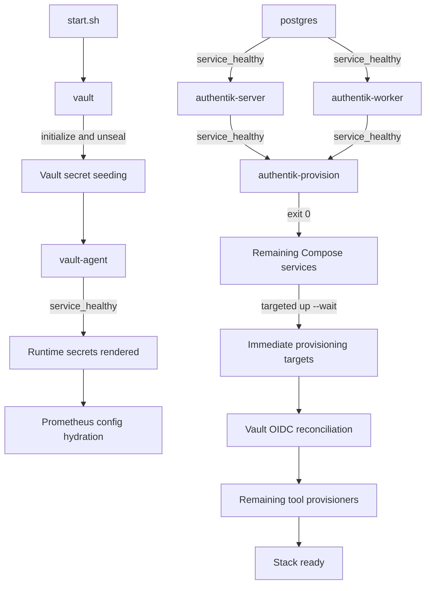

# Startup Dependency Graph

This document is the operational contract for starting `llm-stack`. It describes which
dependencies are enforced by Docker Compose, which transitions remain in `start.sh`, how a
failed provisioning gate stops startup, and how to diagnose or roll back the sequence.

## Design Principles

1. Docker Compose is the canonical runtime dependency engine. Service readiness edges use
   `depends_on` with `service_healthy`; process creation alone is not considered readiness.
2. Reconciliation that must finish exactly once during a stack start is represented by an
   opt-in, one-shot Compose service.
3. `start.sh` remains a thin phase driver where a dependency cannot yet be expressed as a
   network-native Compose job. It must stop on the first failed gate.
4. A normal `docker compose up` must never silently rerun a provisioning job. One-shot jobs use
   the `provisioning` profile and are force-recreated explicitly by `start.sh`.
5. Provisioning jobs communicate over the Compose network. They do not mount the Docker socket,
   invoke a nested Compose process, install runtime packages, require a custom image, or write
   to repository bind mounts.

## Current Executable Graph



The Authentik subgraph is declared in `docker-compose.yml`. `start.sh` executes it with:

```bash
docker compose --profile provisioning up -d --force-recreate authentik-provision
docker compose --profile provisioning wait authentik-provision
```

The first command starts the job only after PostgreSQL, the Authentik server, and the Authentik
worker satisfy their declared health contracts. The second command returns the one-shot
container's exit code. A non-zero exit blocks Vault OIDC and every later provisioning phase.

After that gate succeeds, `start.sh` launches the remaining services and then runs a targeted
`docker compose up -d --wait --wait-timeout 600 chouse-ui langfuse-web litellm`. This prevents
their provisioners from running while an image-level or Compose-level health check is still
starting. This matters for CHouse UI in particular: it creates and migrates its own `chouse_ui`
database during startup; the ClickHouse connection provisioner must not query that database
before CHouse UI is healthy.

LiteLLM has a 180-second healthcheck `start_period` because a clean PostgreSQL database requires
the complete Prisma migration history before Uvicorn can accept requests. Failed probes during
that grace period do not consume the retry budget, while the first successful probe marks the
service healthy immediately. The targeted 600-second wait remains the hard startup deadline.

Open WebUI is deliberately outside this immediate barrier. Its inherited image health check can
report an early failure while first-boot migrations and embedding-model initialization are still
in progress. Its real startup contract is already a two-stage application API barrier in
`start.sh`: wait for `/health`, provision it, restart it, and wait for `/health` again.

## Authentik Provisioning Gate

`authentik-provision` reuses the exact Authentik image digest used by the server and worker. The
image does not contain the third-party Python `requests` package, so the API clients use the
Python standard library through `authentik/scripts/http_client.py`. No package is downloaded at
runtime.

`setup.sh` hydrates the blueprint templates as host-owned generated files before any container
starts. `start.sh` checks that every generated file still matches its template and environment;
it fails with an instruction to rerun `setup.sh` when one is missing or stale. This ownership
boundary keeps the unprivileged job's repository mounts read-only.

The gate then performs these ordered, idempotent operations:

1. Wait for every custom blueprint to settle, retrying errored blueprints sequentially.
2. Bind the embedded outpost to all proxy providers and reconcile the browser-facing host.
3. Wait for a representative Forward-Auth request to return the expected redirect.
4. Reconcile the standard user passwords.

On a clean database, Authentik can continue processing queued blueprint tasks after their API
statuses first report success. The embedded outpost may consequently return `404` while its
provider configuration is still queued. The Forward-Auth gate uses a monotonic 600-second
deadline and returns immediately on the first valid redirect; this bounds a real failure while
allowing the empirically observed cold reconciliation backlog to drain.

`AUTHENTIK_BASE_URL` is mandatory and is set to `http://authentik-server:9000` for the Compose
job. The other required values are passed explicitly from the generated `.env`; none has a
fallback in the job or its scripts.

## Static Enforcement

`.github/scripts/check_startup_graph.py` validates the resolved Compose model rather than the
source YAML text. It rejects:

- a missing Authentik server, worker, or provisioning job;
- a readiness edge weakened from `service_healthy` to `service_started`;
- a missing explicit `ak healthcheck`;
- a LiteLLM healthcheck grace period shorter than 180 seconds;
- removal of the opt-in profile or one-shot restart policy;
- any dependency cycle in the complete resolved Compose graph.

Run the contract checks with:

```bash
make compose-validate
make authentik-tests
```

Both checks are included in `make lint` and therefore in the existing CI path.

## Failure Handling and Diagnostics

If the gate fails, `start.sh` prints its recent logs and exits without configuring Vault OIDC or
running downstream provisioners. Inspect the full state with:

```bash
docker compose ps --all authentik-server authentik-worker authentik-provision
docker compose logs authentik-server authentik-worker authentik-provision --since=10m
docker inspect --format '{{json .State.Health}}' authentik-server
docker inspect --format '{{json .State.Health}}' authentik-worker
```

An exited `authentik-provision` container is expected after success. Its exit code must be zero.
Every `./start.sh` execution force-recreates the job, so configuration changes are reconciled
even when the long-running Authentik containers already exist.

## Rollback

Rollback does not require a database or volume rollback because the reconciliation operations
are idempotent and this change introduces no schema migration.

1. Revert the commit that introduced the Compose job.
2. Restore the direct `bash authentik/provision.sh` call in `start.sh`.
3. Run `make compose-validate` and `make authentik-tests`.
4. Validate the reverted candidate in disposable UAT before any production lifecycle action.

Never remove persistent volumes as part of this rollback.

## Remaining Migration Boundary

The full startup is intentionally not represented as one large Compose graph yet. The Vault,
Ollama, ClickHouse, Langfuse, LiteLLM, and Open WebUI provisioners still depend on host-published
ports, host files, or `docker compose exec`. Moving them directly into containers would create
recursive Docker orchestration or hidden Docker-socket privileges.

Future migrations should follow the proven Authentik pattern one provisioner at a time:

1. Make its API endpoint explicit and network-native.
2. Remove Docker-host inspection and nested Compose calls.
3. Add a one-shot service using an already pinned application image where possible.
4. Add health and completion edges plus static graph assertions.
5. Prove the change on a fresh disposable UAT before considering production promotion.
